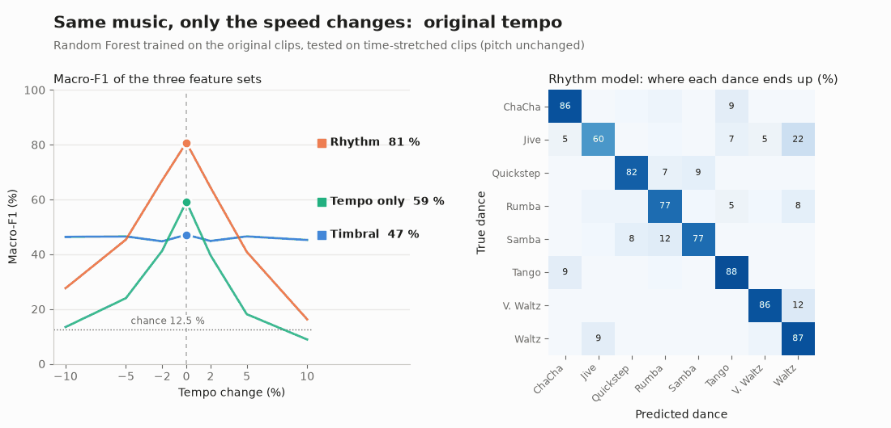
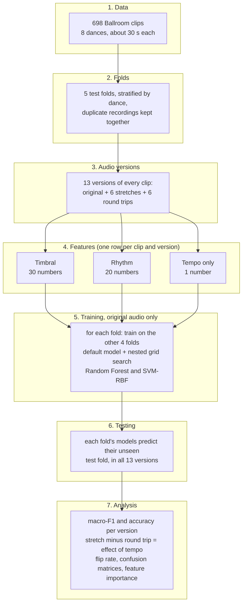
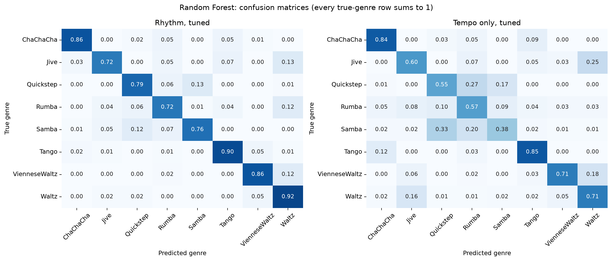
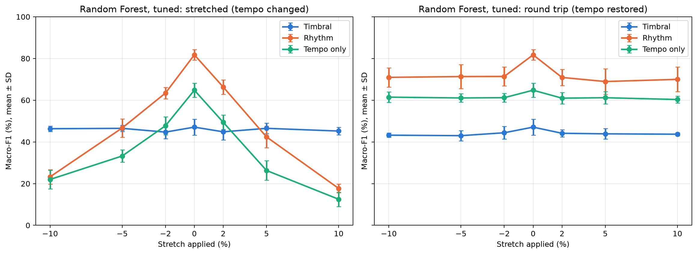
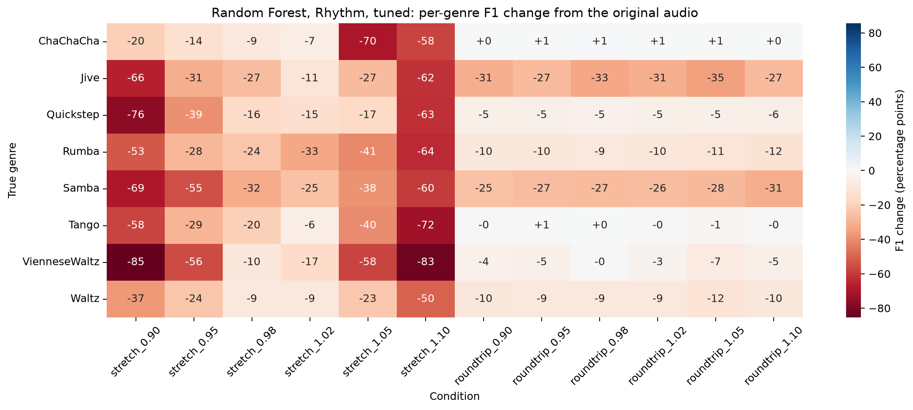
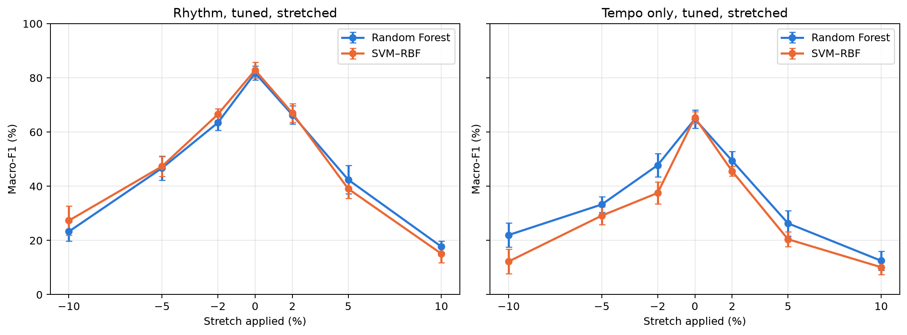

<div align="center">

# Rhythm or Just Tempo?

### Testing a ballroom dance classifier with time-stretched audio


Final project in DT2470 Music Informatics at KTH



</div>

## Summary

In this project we classify the 8 dance styles of the Ballroom dataset from audio. We use three feature sets: timbral features, rhythm features, and a single tempo estimate as a baseline. Each set is tested with a Random Forest and an SVM. The models are trained on the original recordings. Then we time-stretch the test recordings by up to ±10% (the pitch stays the same) and look at how the predictions change.

| Macro-F1, tuned Random Forest | Original | -10% tempo | +10% tempo | Round trip |
|---|---:|---:|---:|---:|
| Rhythm features | 81.8% | 23.3% | 17.7% | 70.6% |
| Tempo only | 64.8% | 22.0% | 12.5% | 61.0% |
| Timbral features | 47.1% | 46.3% | 45.2% | 43.7% |

Mean over the 5 test folds; chance level is 12.5%. The SVM gives almost the same numbers (section 7). "Round trip" means the audio is stretched and then stretched back, so the tempo is the original one but the audio has gone through the same processing.

These are the results of the current run, which uses the updated rhythm extraction (`src/Rythm_extraction.py`) with a tempo range of 60–280 BPM. The two earlier runs are summarised in [section 7.6](#76-earlier-runs).

The rhythm features reach about 82% macro-F1 on the original audio, but only about 18% when the music is played 10% faster. The round trip costs about 11 points, so most of the drop comes from the tempo change itself and less from the processing. Our conclusion is that on Ballroom, most of what the rhythm models get right comes from the tempo of the music. This agrees with earlier work on the same dataset (section 9).

The animation at the top (made from the first run, see section 7.6) shows the same thing. When the tempo moves away from the original, the rhythm and tempo-only models fall towards chance level while the timbral model stays about where it was. The rhythm model starts to predict the dance whose usual tempo the stretched clip now has.

What the project contains:

- Timbral features (MFCCs, zero-crossing rate, spectral centroid) and rhythm features (cyclic tempogram, autocorrelation bar ratios, PLP confidence and PLP alignment) computed with librosa, plus a global tempo estimate that combines the Fourier and the autocorrelation tempogram.
- Stratified and grouped 5-fold cross-validation with a nested grid search, so that duplicate recordings never end up in both training and test data.
- 13 versions of every clip: the original, six time-stretches and six round trips.
- Feature importance, confusion matrices and per-dance results that explain where the drop comes from.
- Extra experiments with tempo-free rhythm features and with timbre and rhythm together ([`extra_experiments/`](extra_experiments/README.md)).

Terms like macro-F1, tempogram or round trip are explained in the [glossary](#17-glossary).

## Contents

1. [Question and hypothesis](#1-question-and-hypothesis)
2. [Dataset](#2-dataset)
3. [Pipeline](#3-pipeline)
4. [Features](#4-features)
5. [Classifiers and evaluation](#5-classifiers-and-evaluation)
6. [The time-stretch experiment](#6-the-time-stretch-experiment)
7. [Results](#7-results)
8. [Discussion](#8-discussion)
9. [Comparison with earlier work](#9-comparison-with-earlier-work)
10. [Checks](#10-checks)
11. [Design choices](#11-design-choices)
12. [Limitations](#12-limitations)
13. [Future work](#13-future-work)
14. [Reproducing the results](#14-reproducing-the-results)
15. [Project layout and tools](#15-project-layout-and-tools)
16. [References](#16-references)
17. [Glossary](#17-glossary)

## 1. Question and hypothesis

Each ballroom dance is danced in a fairly narrow tempo range. A Quickstep is fast and a Waltz is slow. This means that a classifier can do well on this task just by measuring how fast the music is, without learning anything about how it is played (the rhythmic pattern, the metre or the instruments).

Our question: does a dance-style classifier learn the style, or does it use the tempo as a shortcut?

To test this we train on the original recordings and then play the test recordings slightly faster or slower (±2%, ±5%, ±10%) with the pitch unchanged. The music, the instruments and the rhythmic pattern stay the same and only the speed changes. A model that has learned the style should barely be affected. A model that relies on the tempo should get much worse, because the stretched clip now has the tempo of a different dance.

The idea comes from Sturm (2014): change one property of the input in a controlled way and check whether the decisions of the system follow that property.

## 2. Dataset

| | |
|---|---|
| Dataset | Ballroom, from the ISMIR 2004 audio description contest (Gouyon et al., 2006) |
| Clips | 698 excerpts, mono, about 30 s each (29.4-34.1 s) |
| Classes | 8: ChaChaCha 111, Jive 60, Quickstep 82, Rumba 98, Samba 86, Tango 86, VienneseWaltz 65, Waltz 110 |
| Rumba | the three Rumba folders (American, International, Misc) are merged into one class, as in the usual 8-class task |
| Duplicates | 13 known pairs of repeated recordings (list from BallroomAnnotations). One pair, `Albums-Fire-08` / `Albums-Fire-09`, is the same audio with two different labels (ChaChaCha and Samba) |
| Chance level | 15.9% accuracy (always guessing ChaChaCha), 12.5% balanced accuracy / macro recall |

The classes are imbalanced (60 Jive clips against 111 ChaChaCha), so we use macro-F1 as the main metric. It gives every dance the same weight.

## 3. Pipeline

### 3.1 Overview



### 3.2 Step by step

| Step | What happens | Why | Code | Output |
|---|---|---|---|---|
| 1. Load audio | Every `.wav` is read as mono 22,050 Hz audio; the folder name is the label | 22 kHz keeps everything up to 11 kHz, which is enough for these features | `Timbral_extraction.ipynb`; section 3 of the rhythm notebooks | 698 labelled clips |
| 2. Make folds | The clips are split into 5 folds with the same share of each dance; both copies of a duplicate go into the same fold | Every clip is tested exactly once, and never on a copy of a training recording | `make_folds` (every notebook) | `folds.csv` |
| 3. Make versions | Every clip is time-stretched by 0.90, 0.95, 0.98, 1.02, 1.05 and 1.10, and stretched back for the round trips | Change only the tempo; the round trip shows the effect of the processing alone | `apply_condition` | 13 versions per clip (9,074 in total) |
| 4. Extract features | Every version is described by 30 timbral, 20 rhythm and 1 tempo value | Each set contains one kind of information | `timbral_features`, `rhythm_features` | `ballroom_timbral_features.csv`, `timbral_conditions.csv`, `rhythm_conditions.csv` |
| 5. Train | For each fold, a default model and a tuned model (grid search on 3 inner folds) are trained on the other 4 folds, using the original audio only | The settings are chosen without seeing the test fold | `run_nested_cv` | 5 folds × 2 models, for every feature set and classifier |
| 6. Test | Each fold's models predict their test fold, in all 13 versions | Same clips and same models; only the audio version changes | `evaluate_conditions` (rhythm), section 16 (timbral) | `held_out_predictions.csv` |
| 7. Score | Macro-F1, accuracy and flip rate per version, mean ± SD over the 5 folds | Every version is compared with the original audio on the same clips | `classification_scores`, `summarize_folds` | `robustness_summary.csv`, figures |
| 8. Explain | Feature importance, confusion matrices, a tempo check and the comparison of the three feature sets | To find out why the scores change | rhythm notebooks, sections 13-19 | `results/*/comparison/` |

The timbral notebooks do steps 2-8 for the timbral features (step 1 and the features of the original audio come from `Timbral_extraction.ipynb`). The rhythm notebooks do steps 1-8 for the rhythm and tempo-only features. All four notebooks use the same `folds.csv` and the same 13 versions.

### 3.3 Example: one Waltz clip

`Albums-Ballroom_Classics4-02.wav` is a Waltz in test fold 1, so it is predicted by models trained on folds 2-5. The table shows its estimated tempo and the predictions of the tuned Random Forests.

| Version | Estimated tempo `tau_hat` (BPM) | Timbral model | Rhythm model | Tempo-only model |
|---|---:|---|---|---|
| -10% | 156.8 | Waltz | Rumba | Jive |
| -5% | 165.4 | Waltz | Waltz | Waltz |
| -2% | 171.0 | Waltz | Waltz | Waltz |
| original | 174.1 | Waltz | Waltz | Waltz |
| +2% | 177.8 | Waltz | VienneseWaltz | VienneseWaltz |
| +5% | 183.2 | Waltz | Rumba | Rumba |
| +10% | 191.8 | Waltz | Rumba | Rumba |
| round trip of +10% | 174.3 | Waltz | Waltz | Waltz |

The estimated tempo follows the stretch (174.1 × 1.10 ≈ 191.5). When it reaches the VienneseWaltz range (around 178 BPM, see section 8), the rhythm and tempo-only models predict VienneseWaltz, and from about 183 BPM, on the way to Rumba's 199 BPM, they predict Rumba. After the round trip the tempo is back at 174 BPM and the prediction is Waltz again. The timbral model cannot see the tempo and predicts Waltz every time. Section 7 shows the same pattern over all 698 clips.

## 4. Features

### Timbral set (30 inputs)

| Feature | Inputs | Describes |
|---|---:|---|
| MFCC 0-12, mean and std over frames | 26 | the spectral envelope: instruments, production, mastering |
| Zero-crossing rate, mean and std | 2 | noisiness, amount of percussion |
| Spectral centroid, mean and std | 2 | brightness |

We use 22,050 Hz mono audio, frames of 2,048 samples (93 ms), a hop of 512 samples (23 ms) and 128 Mel bands. The mean and std over all frames do not depend on the order of the frames, so these features cannot see the beat. That makes the timbral set a useful negative control: if it changed a lot under time-stretching, the problem would be the processing and not the tempo.

### Rhythm set (20 inputs)

All rhythm features are computed from the novelty curve (spectral flux, `librosa.onset.onset_strength`), which has a peak wherever a note or a drum hit starts. From the novelty curve we compute a Fourier tempogram (with a zero-padded FFT of 4096 points, so there is a value every 0.63 BPM) and an autocorrelation tempogram (from the novelty curve with its mean removed), both with a window of 512 frames (11.9 s, which covers several bars even for the slowest dance). The settings follow the updated `src/Rythm_extraction.py`, except the upper tempo limit (section 11).

| Feature | Inputs | Describes |
|---|---:|---|
| Cyclic tempogram (Müller, 2015, ch. 6) | 15 | the Fourier tempogram from 30 to 480 BPM folded into one octave, 15 bins per octave (4.7% per bin); which tempo classes are present, independent of the octave |
| Bar ratios `R_2_4`, `R_3_4`, `R_4_4` | 3 | autocorrelation at 2, 3 and 4 beats divided by its value at 1 beat, corrected for the Hann window and taking the strongest value within ±5%; meant to describe the metre (a Waltz repeats after 3 beats, a 4/4 dance after 2 and 4). In practice this signal turned out to be weak, see section 12 |
| PLP confidence | 1 | mean of the predominant local pulse curve (60-280 BPM); how clear and steady the pulse is |
| PLP alignment | 1 | cosine similarity between the novelty curve and the PLP curve; how well the accents of the music line up with the pulse |

### Tempo-only set (1 input)

`tau_hat` is the strongest tempo between 60 and 280 BPM of the time-averaged Fourier tempogram multiplied by the time-averaged autocorrelation tempogram (Müller, 2015, p. 330), refined with parabolic interpolation. The Fourier tempogram favours a tempo and its multiples and the autocorrelation tempogram a tempo and its fractions, so their product keeps the tempo both agree on. This baseline shows how much of the task can be solved from the tempo alone.

## 5. Classifiers and evaluation

| | Random Forest | SVM with RBF kernel |
|---|---|---|
| How it decides | many decision trees, each splitting on thresholds of single features | smooth boundaries based on distances between whole feature vectors |
| Scaling | not needed | `StandardScaler` inside the pipeline, fitted on the training clips only |
| Tuned settings | `max_features`, `min_samples_leaf`, `class_weight` (300 trees) | `C`, `gamma`, `class_weight` |

We picked two classifiers that work in very different ways. If both give the same result, the result says something about the features and not about one particular model.

The grids have 18 (RF) and 32 (SVM) combinations in the timbral notebooks. The rhythm notebooks use wider grids (30 and 80), because in a first run the tempo-only search picked a value at the edge of the old grid in most folds. For the SVM this makes sense: with a single input, a useful decision boundary is only a few BPM wide, which needs a large `gamma`.

Evaluation:

- Stratified and grouped 5-fold cross-validation. Every fold has about the same share of each dance (139-140 clips per fold), and both copies of a known duplicate pair are always in the same fold, so a model is never tested on a copy of a training recording. All notebooks use the same `folds.csv`.
- Nested tuning. Inside the 4 training folds, a grid search on 3 grouped inner folds picks the settings with the best macro-F1. The test fold is never used for training or tuning.
- The tuned model is our main result and the default model is kept for reference. We did not switch to whichever of the two looked better on the test folds.
- Results are given as mean ± SD over the 5 test folds. The SD shows the variation between folds and should not be read as a confidence interval.

## 6. The time-stretch experiment

Every clip exists in 13 versions:

| Version | Tempo change | What it tests |
|---|---|---|
| `original` | 0% | the baseline (the models were trained on these) |
| `stretch_r`, r = 0.90, 0.95, 0.98, 1.02, 1.05, 1.10 | -10% … +10% | tempo change plus processing artefacts |
| `roundtrip_r` (stretch by r, then by 1/r) | 0% | processing artefacts only, applied twice |

The stretching is done with librosa's phase vocoder (`librosa.effects.time_stretch`), which changes the speed but keeps the pitch. The phase vocoder is not perfect: it smears sharp attacks. So a drop in performance could come from these artefacts instead of the tempo. The round trip lets us separate the two, since it has the same processing but no net change in tempo. Only the part of a drop that does not also show up in the round trip can be explained by the tempo. The round trip processes the audio twice, so it probably overestimates the artefacts a bit, which makes our estimate of the tempo effect conservative.

## 7. Results

All numbers are for the tuned models, averaged over the 5 test folds. All tables and figures are in [`results/`](results/).

### 7.1 Original audio

| Feature set | Classifier | Accuracy (%) | Macro-F1 (%) |
|---|---|---|---|
| Timbral | Random Forest | 48.71 ± 3.62 | 47.22 ± 3.88 |
| Timbral | SVM-RBF | 49.57 ± 3.47 | 47.20 ± 3.77 |
| Rhythm | Random Forest | 82.24 ± 2.19 | 81.76 ± 2.56 |
| Rhythm | SVM-RBF | 82.95 ± 2.75 | 82.85 ± 2.86 |
| Tempo only | Random Forest | 65.90 ± 3.56 | 64.80 ± 3.33 |
| Tempo only | SVM-RBF | 67.05 ± 1.71 | 65.35 ± 2.14 |

Chance level is 15.9% accuracy and 12.5% macro recall, so all three feature sets are well above chance. The rhythm set is the best, and the tempo alone already reaches about 65%.

<p align="center"></p>

Confusion matrices of the tuned Random Forest on the original audio (left: rhythm, right: tempo only). The tempo-only model gets every dance right more often than chance, but it mixes up dances with similar tempi: Samba with Quickstep and Rumba (around 200 BPM), and Waltz with Jive (around 170 BPM).

### 7.2 Macro-F1 (%) when only the tempo changes

| Tempo change | Timbral RF | Timbral SVM | Rhythm RF | Rhythm SVM | Tempo RF | Tempo SVM |
|---|---:|---:|---:|---:|---:|---:|
| -10% | 46.3 | 47.7 | 23.3 | 27.3 | 22.0 | 12.2 |
| -5% | 46.5 | 47.6 | 46.7 | 47.3 | 33.3 | 29.1 |
| -2% | 44.7 | 47.1 | 63.4 | 66.5 | 47.8 | 37.5 |
| 0% (original) | 47.1 | 47.4 | 81.8 | 82.9 | 64.8 | 65.3 |
| +2% | 44.8 | 47.7 | 66.3 | 67.0 | 49.4 | 45.6 |
| +5% | 46.5 | 47.5 | 42.4 | 39.0 | 26.3 | 20.4 |
| +10% | 45.2 | 47.0 | 17.7 | 15.1 | 12.5 | 10.1 |
| Round trip, mean of 6 | 43.7 | 45.1 | 70.6 | 73.4 | 61.0 | 63.1 |

<p align="center"></p>

Macro-F1 of the tuned Random Forest. Left: stretched test audio. Right: round trip (stretched and stretched back). The [SVM version](results/rhythm_svm_rbf/comparison/feature_set_comparison.png) of this figure looks almost the same.

The timbral values at 0% (47.1 and 47.4) are slightly different from table 7.1 (47.22 and 47.20). This is because the stretch experiment recomputes the features from the audio. The recomputed features differ from the training table by at most 0.6% of each feature's spread, which changes 1 of the 698 tuned predictions.

### 7.3 How much of the drop comes from the tempo?

Average change in macro-F1 over the six stretches, compared with the six round trips (percentage points):

| Feature set | Classifier | Stretched | Round trip (processing only) | Caused by tempo | Predictions that change under stretching |
|---|---|---:|---:|---:|---:|
| Timbral | RF | -1.4 | -3.4 | ≈ 0 | 15% |
| Timbral | SVM | -0.0 | -2.3 | ≈ 0 | 14% |
| Rhythm | RF | -38.5 | -11.2 | -27.3 | 52% |
| Rhythm | SVM | -39.1 | -9.5 | -29.6 | 52% |
| Tempo only | RF | -32.9 | -3.8 | -29.2 | 59% |
| Tempo only | SVM | -39.5 | -2.2 | -37.3 | 68% |

"Caused by tempo" is the stretched value minus the round-trip value. For the timbral set the stretch hurts less than the round trip, so we see no tempo effect there.

<p align="center"></p>

Change in F1 per dance for the rhythm Random Forest. Every dance gets worse under stretching, by 50-83 points at +10% (left six columns). The round trips (right six columns) cost 0-12 points for most dances, but 25-35 points for Jive and Samba, the dances most affected by the processing.

### 7.4 Which features the models use

Group permutation importance: we shuffle one feature family across the test clips and measure how much macro-F1 drops (tuned models, mean of 5 folds × 5 repeats).

| Rhythm family | Inputs | Drop, RF (pp) | Drop, SVM (pp) |
|---|---:|---:|---:|
| Cyclic tempogram | 15 | 65.7 | 63.9 |
| PLP confidence and alignment | 2 | 14.0 | 19.4 |
| Bar ratios | 3 | 2.3 | 2.9 |

| Timbral family | Inputs | Drop, RF (pp) | Drop, SVM (pp) |
|---|---:|---:|---:|
| MFCC | 26 | 29.6 | 31.9 |
| Spectral centroid | 2 | 7.4 | 3.2 |
| Zero-crossing rate | 2 | 0.5 | 0.4 |

The rhythm model depends mostly on the cyclic tempogram, which is the rhythm feature that contains the tempo class (see section 8). The two PLP inputs come second, mostly because of the PLP alignment.

### 7.5 Sanity checks

- Does the tempo estimate follow the stretch? The median of `tau_hat(stretched) / tau_hat(original)` is equal to the stretch rate (0.90 … 1.10, to two decimals). 89-95% of the clips are within 1% of the expected ratio. Octave jumps, where the estimate switches between a tempo and its double, are 2-7% of the clips depending on the stretch, with the most at +10%. After a round trip, 89-92% of the clips are back within 1% of their original tempo ([figure](results/rhythm_random_forest/comparison/tempo_check.png)).
- Could the timbral model be recognising albums from their loudness? `mfcc_00` mostly measures loudness, which depends on the mastering. Without it (28 inputs) the tuned macro-F1 is 46.11% (RF) and 48.51% (SVM), compared with 47.22% and 47.20% with it, so the model does not depend on it.
- Does the tuning matter? Not much for the timbral and rhythm sets: the change is within the SD between folds and sometimes negative (rhythm RF: 82.27% default, 81.76% tuned). It matters a lot for the tempo-only SVM (51.70% → 65.35%).

### 7.6 Earlier runs

We ran the experiment three times. Only the rhythm features changed between the runs; the folds, classifiers, tuning, stretching and timbral features stayed the same.

| Run | Rhythm features | Where |
|---|---|---|
| First run | first version of `src/Rythm_extraction.py`: window of 384 frames, Fourier tempogram without zero padding, `tau_hat` from the Fourier tempogram only, no window correction, PLP confidence only (19 inputs), tempo range 40-240 BPM | git history (commit `df9d0b0`) |
| Second run | updated `src/Rythm_extraction.py` (section 4), with the tempo range of the script, 60-220 BPM | [`previous_runs/max_tempo_220/`](previous_runs/max_tempo_220/README.md) |
| **Current run** | updated `src/Rythm_extraction.py`, tempo range 60-280 BPM | this README and `results/` |

Tuned models, Random Forest / SVM:

| | First run | Second run | Current run |
|---|---:|---:|---:|
| Rhythm, macro-F1 on original audio (%) | 80.7 / 80.2 | 81.9 / 82.7 | 81.8 / 82.9 |
| Rhythm, macro-F1 at +10% (%) | 16.2 / 17.6 | 15.1 / 15.9 | 17.7 / 15.1 |
| Rhythm, drop in the round trip (pp) | -6.1 / -5.3 | -11.9 / -12.2 | -11.2 / -9.5 |
| Rhythm, drop caused by tempo (pp) | -31.0 / -31.4 | -27.1 / -26.6 | -27.3 / -29.6 |
| Tempo only, macro-F1 on original audio (%) | 59.1 / 60.0 | 62.6 / 64.7 | 64.8 / 65.3 |
| Tempo only, drop caused by tempo (pp) | -35.0 / -38.4 | -30.9 / -37.2 | -29.2 / -37.3 |
| `tau_hat` follows the stretch within 1% (range over the six stretches) | 71-91% | 75-91% | 89-95% |
| `tau_hat` within 4% of the BPM in the dataset logs (original audio) | 46% | 60% | 41% |
| `tau_hat` within 4% of that BPM or a simple multiple (×2, ×3, ×½, ×⅓) | 83% | 94% | 95% |

The updated extraction makes the rhythm and tempo-only models a little more accurate on the original audio, but more sensitive to the processing itself: the round trip costs the rhythm set about twice as much. With the upper limit of 220 BPM, fast dances stretched by +10% go over the limit and the tempo estimate jumps (only 75% of the clips follow the stretch at +10%), so the current run uses 280 BPM. With 280 BPM the estimate is more often at double the labelled tempo, but it follows every stretch best, and following the stretch is what this experiment needs. The conclusion is the same in all three runs: about 27-31 points of the rhythm score are lost when only the tempo changes.

**How we chose the tempo range.** Before the current run we tested several tempo ranges for the updated tempo estimate. For every clip and every stretch, the estimate counts as correct if it changes exactly with the stretch: if a clip is played 10% faster, its real tempo is exactly 10% higher, so the estimate on the stretched clip should be the estimate on the original clip × the stretch rate, within 1%. This check does not use the dataset labels or any classifier results. The table shows the share of the 698 clips that pass (%):

| Tempo range | -10% | -5% | -2% | +2% | +5% | +10% | Average |
|---|---:|---:|---:|---:|---:|---:|---:|
| First run (first version of the tempo estimate, 40-240) | 71 | 79 | 84 | 91 | 88 | 88 | 83 |
| 60-220 (second run, the value in `src/Rythm_extraction.py`) | 80 | 90 | 88 | 89 | 91 | 75 | 85 |
| 60-240 | 76 | 78 | 82 | 87 | 88 | 87 | 83 |
| 60-260 | 94 | 92 | 91 | 90 | 84 | 73 | 88 |
| **60-280 (current run)** | **95** | **94** | **93** | **92** | **92** | **89** | **93** |
| 60-300 | 95 | 94 | 93 | 93 | 93 | 92 | 93 |
| 110-220 | 80 | 94 | 91 | 93 | 93 | 75 | 88 |
| 120-240 | 71 | 77 | 83 | 89 | 89 | 88 | 83 |

Every upper limit causes problems for dances whose estimated tempo, or half of it, lies close to the limit. With 220 or 260 BPM, fast dances stretched by +10% go over the limit (Quickstep at about 204-211 BPM becomes 224-232 BPM). With 240 BPM, a song at about 115 BPM can also be estimated at 230 BPM, so slower songs start to jump at small stretches. With 280 or 300 BPM even the fastest stretched songs (about 270 BPM) stay inside the range, and the estimate follows every stretch better than in the first run. 280 and 300 BPM give almost the same results; we use 280 BPM.

## 8. Discussion

### Why the tempo alone gets about 65%

Each dance has its own tempo range. The table compares our estimated tempo per dance with the nominal dance tempi listed by Dixon et al. (2004):

| Dance | Nominal tempo (BPM) | Our median `tau_hat` (BPM) | Middle 50% of clips |
|---|---|---:|---|
| Tango | 128-132 | 255.6 | 128.7-256.5 (two groups, around 129 and around 256) |
| ChaChaCha | 128 | 248.0 | 247.3-248.2 |
| Jive | 176 | 172.1 | 166.7-175.0 |
| Waltz | 84-90 | 168.8 | 87.0-173.6 (two groups, around 87 and around 170) |
| VienneseWaltz | 174-180 | 177.7 | 175.9-180.1 |
| Rumba | 104 | 199.4 | 191.7-207.7 |
| Samba | 200 (beat counted in eighth notes) | 199.5 | 109.7-203.7 (two groups, around 110 and around 200) |
| Quickstep | 200-208 | 203.7 | 201.7-205.7 |

For Jive, VienneseWaltz, Quickstep and most Samba clips the estimate is equal or close to the nominal tempo. For almost all ChaChaCha and Rumba clips, most Tango clips and about half of the Waltz clips, it is twice the nominal tempo. This is called an octave error, and it is the most common mistake of tempo estimators (Gouyon et al., 2004). With the range of 60-280 BPM the estimate picks the double tempo more often than with a lower upper limit, but it does so consistently (section 7.6). Quickstep, VienneseWaltz, ChaChaCha and Tango form tight groups, so the tempo identifies them quite well, although ChaChaCha and Tango are only 3% apart. The clips with a doubled tempo end up on top of other dances: Waltz on top of Jive (168.8 vs 172.1 BPM), and Rumba on top of Samba and Quickstep (around 200 BPM). This is why the tempo-only model has its lowest F1 on Samba (0.46 for RF, 0.38 for SVM).

### Why even ±2% hurts

The tempo groups are only a few percent apart. VienneseWaltz is 3% above Waltz and Jive, Quickstep is 2% above Rumba and Samba, and Tango is 3% above ChaChaCha. A 2% stretch (about 4 BPM at 200 BPM) is enough to move many clips across a decision boundary. At ±2% the tempo-only model loses 15-28 points and the rhythm model 16-18 points. For the same reason a ±2% stretch cannot be used as a "no effect" control, which is why we use the round trip for that.

### Where the predictions go

The errors are not random: the predictions move to the dance whose tempo the stretched clip now has. The most common changes for the tempo-only Random Forest (prediction on the original → prediction on the stretched clip) are:

- At +10%: ChaChaCha (about 248 → 273 BPM) becomes Tango (around 256). Rumba (199 → 219) and Quickstep (204 → 224) become ChaChaCha. Waltz (169 → 186), Jive (172 → 189) and VienneseWaltz (178 → 195) become Rumba (around 200).
- At -10%: Quickstep (204 → 183) becomes Rumba. Tango (256 → 230) becomes ChaChaCha (around 248). VienneseWaltz (178 → 160) and Waltz (169 → 152) become Jive.
- The rhythm models move in the same way, and their predictions collect in a few classes. At +10% the rhythm Random Forest predicts Rumba for 273 of the 698 clips, although only 98 of them are Rumba. This is the dark Rumba column in the animation at the top.

Because the errors are systematic, the tempo-only model at +10% falls to 12-15% accuracy, about the level of random guessing among 8 dances (12.5%).

### Why the rhythm set drops like the tempo-only set

The strongest part of the rhythm set contains the tempo. The cyclic tempogram is not shifted to a reference bin, so its profile tells which tempo class the clip is in, and a 10% stretch moves the profile by about 2 of its 15 bins. Shuffling the cyclic tempogram costs 64-66 points of macro-F1. The two PLP inputs, which do not contain the tempo directly, cost 14-19 points, and the bar ratios 2-3 points. So the model is mostly reading the tempo class.

### Why the round trip hurts the rhythm set more than the tempo-only set

The phase vocoder smears drum attacks, and the novelty curve is built from those attacks, so the shape of the tempogram changes and the rhythm set loses about 10-11 points. That is more than in the first run (about 6 points, section 7.6), mostly through the PLP inputs and mostly for Jive and Samba. The position of the main tempo peak hardly moves (89-92% of the clips keep their tempo within 1%), so the tempo-only model loses only 2-4 points.

### Why the timbral features are stable but weak

The mean and std over frames hardly change when the frames come faster, and the phase vocoder keeps the spectrum, so the stretched features stay close to the original ones. The small drop comes from the processing (the round trip hurts even more). On its own, timbre only reaches about 47%, because many dances share instruments and production style. The most common confusions are Samba ↔ ChaChaCha (Latin percussion), VienneseWaltz ↔ Waltz / Tango (orchestral ballroom sound) and Rumba → Waltz.

### Random Forest and SVM agree

On the original audio the two classifiers are within about 1 point of macro-F1 for every feature set. Under stretching they follow the same curves for the rhythm and timbral sets (table 7.2, at most about 4 points apart at a single stretch). For the tempo-only set the SVM is more fragile: up to 10 points lower at a single stretch, and its drop caused by the tempo is 8 points larger (table 7.3).

<p align="center"></p>

Random Forest (blue) and SVM-RBF (orange) on stretched audio, for the rhythm set (left) and the tempo-only set (right).

### Conclusion

On Ballroom, a model with rhythm features gets about 82% macro-F1, but on average about 27-30 of those points are lost when only the tempo changes, and the model then predicts the dance that matches the new tempo. Most of its accuracy comes from the tempo, so a high score on this dataset does not show that a model has learned the rhythmic style of the dances. The [extra experiments](extra_experiments/README.md) show that without the tempo, rhythm features still get 66-72%, and timbre together with tempo-free rhythm features gets 73-76% without losing anything to tempo changes.

## 9. Comparison with earlier work

Our main findings agree with earlier studies on the same 698 Ballroom clips. The numbers cannot be compared directly, since those studies use other classifiers, folds and tempo estimators, but the overall pattern is the same.

| Our result | Earlier work | Consistent? |
|---|---|---|
| Tempo alone, estimated from the audio: about 65% | Tempo alone, annotated by hand: 82.3%; tempo alone, estimated by two tempo trackers: 41-53% (Gouyon et al., 2004) | Yes. Ours is between the two; estimated tempi contain octave errors, which Gouyon et al. give as the reason for their drop |
| Rhythm features: about 82% | Fully automatic rhythm descriptors: 46-80%; up to 90% with the hand-annotated tempo added (Gouyon et al., 2004); 96% with hand-corrected bar positions plus tempo (Dixon et al., 2004) | Yes, within the usual range for fully automatic features |
| Our rhythm features without the tempo (shifted cyclic tempogram, extra experiments): 66% | Tempo-independent rhythm patterns alone: about 50% (Dixon et al., 2004); tempo-independent periodicity peaks alone: 51% (Gouyon et al., 2004) | Yes; without the tempo, rhythm descriptors are clearly weaker on Ballroom (ours a bit less than the earlier ones) |
| A ±10% tempo change makes the rhythm and tempo models collapse, and predictions move to the dance with the new tempo (e.g. Quickstep at about 224 BPM becomes ChaChaCha) | For a state-of-the-art Ballroom system, about 80% of the test clips get 3-6 different labels within ±10% stretching, and Jive and Quickstep stretched to 229-232 BPM all become Cha Cha (Sturm, 2016). Standard rhythm features drop to 17-20% when training songs of the same style and similar tempo are removed (Jensen et al., 2009) | Yes, the same tempo shortcut |
| Tempo-only confusions: Samba, Rumba and Quickstep (all around 200 BPM), Waltz ↔ Jive (around 172 BPM), Tango ↔ ChaChaCha | With the annotated tempo alone, the strongest confusions are Rumba ↔ Samba and Tango ↔ Cha Cha (Gouyon et al., 2004) | Partly. Rumba/Samba and Tango/ChaChaCha are also confused in our data; the extra Waltz ↔ Jive and Quickstep confusions come from octave errors in the estimated tempo |
| Octave errors in `tau_hat` | Tempo estimators confuse metrical levels: ×2, ×½, ×⅓, ×⅔ (Gouyon et al., 2004; Müller, 2015, ch. 6) | Yes |
| The round trip costs the rhythm set about 10-11 points | Phase-vocoder time-stretching smears sharp attacks (Driedger & Müller, 2016), and the rhythm features are built from those attacks | Yes |
| Timbre alone: about 47% | We did not find a directly comparable number for frame-averaged MFCCs on Ballroom. Dixon et al. reach 96% without any spectral features, so on this dataset most of the information is in rhythm and tempo | Plausible |

## 10. Checks

These checks were done for the first run (section 7.6). The current run uses the same code for the folds, the training and the evaluation; only the rhythm features changed. For those we checked that the notebook code gives the same values as the updated `src/Rythm_extraction.py`, with the upper tempo limit as the only difference.

| Check | What we did | Result |
|---|---|---|
| Code review | Went through all notebooks and scripts: folds, nested CV, scaling inside the pipeline, metrics, sign conventions, feature formulas | No logic errors; a few comments were corrected without changing any computation |
| Reproducibility | Reran all four notebooks in an empty folder, starting from the raw audio | `folds.csv` and the rhythm features were identical byte for byte, the timbral features equal up to float rounding, and every results table identical except for the column with training times |
| Tests with known answers | Ran the notebooks' feature code on synthetic click tracks | The tempo estimate is the true tempo (8 of 11 tempi, within 1%) or a multiple of it (3 of 11), which is the expected behaviour of the Fourier tempogram. Under a stretch it follows the new tempo within 0.2% or jumps by exactly one octave (as in the real data, section 7.5), and after a round trip it is back within 0.1%. The cyclic tempogram puts every click track in the predicted bin, and +10% moves it by 2 bins (theory: 2.06). The bar ratios move in the right direction for 3/4 and 4/4 accents. The PLP curve has a maximum of exactly 1 |
| Notebooks vs scripts | Compared the notebook features with `src/Rythm_extraction.py` and `src/Timbral_extraction.py` on real clips | Identical (the rhythm notebooks only add the `tau_hat` refinement described in section 4) |
| Leakage test | Repeated the whole cross-validation with shuffled labels (3 shuffles, RF and SVM, rhythm and tempo-only) | 11-15% accuracy, which is chance level. If label information leaked into the features or folds, the score would stay high |
| Recomputed metrics | Recomputed every fold metric and every time-stretch number from the saved predictions with separate numpy code instead of scikit-learn | Same numbers (differences around 1e-16) |

## 11. Design choices

<details>
<summary>Click to expand</summary>

| Choice | Reason | Why not the alternative |
|---|---|---|
| Hand-crafted features + classical classifiers | Each feature set contains one kind of information (timbre, rhythm, tempo), so we can tell what a model relies on. 698 clips is also a small dataset | A CNN on spectrograms could use any shortcut, which would be much harder to trace; it would also need far more data |
| Random Forest and SVM-RBF | Two very different decision rules (axis-aligned thresholds vs smooth distance-based boundaries). If they agree, the result is about the features | With only one classifier, the result could be a quirk of that model |
| Macro-F1 as the main metric | The classes are imbalanced (60-111 clips) and every dance should count equally | Accuracy rewards doing well on the large classes |
| Grouped + stratified folds | There are 13 duplicate pairs, and a duplicate in both train and test would inflate the scores | Plain `StratifiedKFold` can put the two copies in different folds |
| Nested cross-validation | The hyperparameters are chosen without using the test fold | Tuning on the same folds we report on gives optimistic scores |
| Report the tuned model, keep the default for reference | The tuned settings were chosen before seeing any test results | Choosing default or tuned by test score would be selection on the test set |
| Phase-vocoder time-stretching | Changes the speed and keeps the pitch | Resampling (playing faster) also raises the pitch and changes the timbre, so two things would change at once |
| Round trip as the control | Same processing, no net change in tempo, so it isolates the artefacts | ±2% still changes the tempo (and costs the tempo-only model about 20 points) |
| Stretch only the test audio | Our question is how models trained on normal music behave | Training on stretched audio (augmentation) is a possible fix rather than a test (see future work) |
| Estimated tempo (`tau_hat`) for the tempo-only baseline | This is what an audio system can actually measure, and it moves with the stretch | The annotated tempo is metadata; it does not change when the audio is stretched, so it cannot test the shortcut |
| Zero-padded Fourier tempogram and combined `tau_hat` | Without zero padding the Fourier tempogram has a value only every 5-7 BPM, so a ±2% stretch often did not change `tau_hat`. Zero padding gives a value every 0.63 BPM, the product with the autocorrelation tempogram avoids many octave errors, and a parabola through the peak gives sub-bin precision | A finer tempogram without zero padding needs a much longer window, which blurs tempo changes within a clip |
| Tempo range 60-280 BPM | Covers the tempo of every dance even after a +10% stretch, so the tempo estimate follows the stretch for 89-95% of the clips at every stretch rate (section 7.6). Chosen only from this check, not from classifier results | `src/Rythm_extraction.py` uses 220 BPM; then fast dances stretched by +10% (Quickstep at about 224-232 BPM) go over the limit and the estimate is forced to jump |
| PLP alignment instead of `plp_peak_ratio` | librosa normalises the PLP curve to a maximum of 1, so the old peak ratio was exactly 1 / PLP confidence. The PLP alignment adds new information: how well the accents line up with the pulse | Keeping the peak ratio would count the same information twice |
| Cyclic tempogram not shifted | Kept as in our original extraction (`src/Rythm_extraction.py`, `cyclic_shift=False`), so we test the rhythm features as we first designed them | The shifted (tempo-invariant) version is tested in the [extra experiments](extra_experiments/README.md) |
| 512-frame tempogram window (11.9 s) | Covers several bars even for the slowest dance; the setting of the updated `src/Rythm_extraction.py` | Shorter windows give a coarser tempo resolution; longer ones blur local changes |

</details>

## 12. Limitations

- Tempo is part of what defines a ballroom dance. Near the edge of a dance's tempo range, a ±10% stretch could make the label itself questionable. The ±2% and ±5% results also drop strongly and are less affected by this.
- Octave errors. `tau_hat` is often twice the danced tempo (almost all ChaChaCha and Rumba clips, most Tango clips and about half of the Waltz clips), so for those clips the bar ratios are measured at the half-beat level. The tempo-only baseline uses the tempo as estimated, octave errors included.
- The bar ratios carry only a weak metre signal and add only 2-3 points. In the first run they separated the 3/4 dances from the 4/4 dances only weakly (AUC 0.51 for `R_3_4` alone and 0.63 for `R_3_4 - R_4_4`, where 0.5 is chance), partly because the analysis window makes the autocorrelation smaller at longer lags. The current run corrects for that window, but octave errors still move the ratios to the wrong level, and the log compression in the novelty curve flattens the difference between strong and weak beats.
- The PLP features are sensitive to the time-stretching process: the round trip costs the rhythm set about 10-11 points, against about 6 points in the first run, which did not have the PLP alignment. Also, librosa's PLP function (version 1.0) normalises only about half of the frames as intended, because of how NumPy compares complex numbers. The PLP values still behave sensibly (steady click tracks give about 0.3, noise about 0.13), but they are not exactly the textbook PLP.
- Album effects. Duplicates are kept together, but clips from the same album can still end up in both training and test folds. Albums share mastering and instruments, which may help the timbral model.
- One duplicate pair has two different labels (`Albums-Fire-08` / `-09`), so one of the two clips is always counted as an error.
- Only five folds. The SD over 5 folds describes the variation but is not a confidence interval, and small differences (for example RF vs SVM, or default vs tuned) are within the noise.
- One dataset and one stretching method. The round trip controls for the artefacts of the phase vocoder, but other stretching methods or datasets could behave differently.

## 13. Future work

- A shifted (tempo-invariant) cyclic tempogram: done in the [extra experiments](extra_experiments/README.md). Without the tempo the rhythm features still get 66%, and timbre with tempo-free rhythm features 73-76%, with no loss from tempo changes.
- Find out which of the updated rhythm features makes the models sensitive to the stretching process (most likely the PLP alignment).
- Better metre features: the bar ratios are now window-corrected but still weak; a tempo estimate with fewer octave errors would help them.
- Tempo augmentation: train on stretched copies and see whether the shortcut disappears and how much accuracy is left.
- More data, for example the Extended Ballroom dataset, to check whether the same shortcut shows up there.

## 14. Reproducing the results

Versions we used: Python 3.14.6, numpy 2.5.2, pandas 3.0.5, scikit-learn 1.9.0, librosa 1.0.0 for the first run, and Python 3.12.13, numpy 2.5.3, pandas 3.0.6, scikit-learn 1.9.1, librosa 1.0.0 for the current run, plus scipy, matplotlib, seaborn and joblib. All random seeds are fixed (`RANDOM_SEED = 2026`), so a rerun gives the same folds and the same numbers.

```bash
pip install numpy pandas scipy scikit-learn librosa matplotlib seaborn joblib jupyter
```

Run the notebooks from the repository folder, since they read and write files next to themselves:

1. Get the Ballroom audio (ISMIR 2004 Ballroom dataset; in the course it was handed out as `data1.tar.gz`) and extract it, for example to `data1/BallroomData/`.
2. Set `DATASET_DIR` in the configuration cell of each notebook to that `BallroomData` folder. The two timbral experiment notebooks currently point to an absolute path on our machine; the rhythm notebooks and `Timbral_extraction.ipynb` expect `BallroomData/` in the same folder.
3. Run `Timbral_extraction.ipynb` to get `ballroom_timbral_features.csv` (the 30 timbral features of the original clips). The file is already in the repository, so this step can be skipped.
4. Run `Timbral_Random_Forest.ipynb` and `Timbral_SVM_RBF.ipynb`. The first one creates `folds.csv` and computes the timbral features of all 13 versions (`timbral_conditions.csv`); the second one reuses both.
5. Run `Rhythm_Random_Forest.ipynb` and `Rhythm_SVM_RBF.ipynb`. The first one computes the rhythm features of all 13 versions (`rhythm_conditions.csv`); the second one reuses it.
6. The model comparisons read the results of the partner notebook, so after running a pair once, rerun the first notebook of the pair to fill in its comparison sections.

Computing the 13 versions of every clip takes about 14 minutes for the timbral features and 14 minutes for the rhythm features (8 parallel jobs). Everything else takes a few minutes. A full rebuild from the raw audio in an empty folder gives the same `folds.csv`, feature files and results tables (up to float rounding in the last digits of the timbral features).

[`src/Rythm_extraction.py`](src/Rythm_extraction.py) contains our rhythm feature code. The rhythm notebooks use the same code, with the upper tempo limit at 280 instead of 220 BPM (section 11). `ballroom_rhythm_features.csv` was made by the first version of the script and is only used for a comparison in the rhythm notebooks. The animation at the top was made from the saved CSV files of the first run and does not need the audio.

## 15. Project layout and tools

```
music-informatics-project/
├── README.md
│
├── Timbral_extraction.ipynb          step 1  timbral features of the original clips (librosa + from-scratch numpy)
├── Timbral_Random_Forest.ipynb       step 2  timbral experiment, Random Forest
├── Timbral_SVM_RBF.ipynb             step 2  timbral experiment, SVM-RBF
├── Rhythm_Random_Forest.ipynb        step 3  rhythm + tempo-only experiment, Random Forest (main comparison)
├── Rhythm_SVM_RBF.ipynb              step 3  rhythm + tempo-only experiment, SVM-RBF
├── ballroom_timbral_features.csv     input   30 timbral features per original clip (read by the timbral notebooks)
├── ballroom_rhythm_features.csv      input   output of the first version of src/Rythm_extraction.py (comparison only)
│
├── extra_experiments/                tempo-free rhythm features and timbre + rhythm (own README)
├── previous_runs/max_tempo_220/      the second run (tempo range 60-220 BPM), kept for comparison
├── src/                              standalone feature extraction scripts
│   ├── Timbral_extraction.py                 same functions as Timbral_extraction.ipynb, importable
│   └── Rythm_extraction.py                   rhythm features (cyclic tempogram, bar ratios, PLP, tau_hat)
├── data/
│   └── ballroom_timbral_features_scratch.csv  timbral features from the from-scratch numpy version (cross-check)
├── results/                          all tables (.csv) and figures (.png), written by the notebooks
│   ├── random_forest/, svm_rbf/                  timbral notebooks (+ time_stretch/)
│   └── rhythm_random_forest/, rhythm_svm_rbf/    rhythm notebooks: rhythm/, tempo_only/, comparison/
└── assets/
    └── tempo_stretch.gif             animation at the top of this page
```

The notebooks and the two input CSV files are in the top folder because the notebooks read their inputs and write `results/` relative to their own location. The notebooks also create `folds.csv` (the 5 test folds shared by all notebooks) and `timbral_conditions.csv` and `rhythm_conditions.csv` (features of 698 clips × 13 versions); these files and the audio are not stored in git. Rerunning `Timbral_extraction.ipynb` writes a new copy of the scratch CSV next to the notebook.

| Part | Tools |
|---|---|
| Audio loading, features, time-stretching | librosa (`onset_strength`, `fourier_tempogram`, `tempogram`, `beat.plp`, `feature.mfcc`, `effects.time_stretch`), numpy, scipy |
| Classifiers and evaluation | scikit-learn (`RandomForestClassifier`, `SVC`, `StratifiedGroupKFold`, `GridSearchCV`, `Pipeline`) |
| Data handling and parallel extraction | pandas, joblib |
| Figures | matplotlib, seaborn |
| Environment | Jupyter notebooks, Python 3.14 |

## 16. References

- F. Gouyon, A. Klapuri, S. Dixon, M. Alonso, G. Tzanetakis, C. Uhle, P. Cano. *An experimental comparison of audio tempo induction algorithms.* IEEE Transactions on Audio, Speech, and Language Processing, 2006. (Ballroom dataset)
- F. Gouyon, S. Dixon, E. Pampalk, G. Widmer. *Evaluating rhythmic descriptors for musical genre classification.* AES 25th International Conference, 2004.
- S. Dixon, F. Gouyon, G. Widmer. *Towards characterisation of music via rhythmic patterns.* ISMIR, 2004.
- J. H. Jensen, M. G. Christensen, S. H. Jensen. *A tempo-insensitive representation of rhythmic patterns.* EUSIPCO, 2009.
- B. L. Sturm. *A simple method to determine if a music information retrieval system is a "horse".* IEEE Transactions on Multimedia, 2014.
- B. L. Sturm. *The "horse" inside: seeking causes behind the behaviours of music content analysis systems.* arXiv:1606.03044, 2016.
- M. Müller. *Fundamentals of Music Processing.* Springer, 2015, chapter 6 (tempograms, cyclic tempogram, PLP).
- J. Driedger, M. Müller. *A review of time-scale modification of music signals.* Applied Sciences 6(2), 2016.
- BallroomAnnotations (CPJKU), https://github.com/CPJKU/BallroomAnnotations (list of duplicate recordings).
- librosa, https://librosa.org; scikit-learn, https://scikit-learn.org.

## 17. Glossary

<details>
<summary>Click to expand</summary>

| Term | Meaning |
|---|---|
| BPM, tempo | Beats per minute: how fast the beat of the music is |
| Feature | A number computed from the audio that describes one property of it, for example its brightness |
| Timbre | The "colour" of a sound: what makes a violin sound different from a drum at the same pitch and loudness |
| MFCC | Mel-frequency cepstral coefficients: about 13 numbers that summarise the overall shape of the spectrum; the standard way to describe timbre |
| Zero-crossing rate | How often the waveform crosses zero; high for noisy, percussive sounds |
| Spectral centroid | The "centre of mass" of the spectrum, in Hz; high for bright sounds |
| Onset, novelty curve | A curve that rises whenever a new note or drum hit starts |
| Tempogram | A representation of which tempi are present in the music at each moment |
| Cyclic tempogram | A tempogram where for example 60, 120 and 240 BPM count as the same tempo class (folded into one octave) |
| Octave error | A tempo estimate that is double (or half) the tempo people dance to |
| Metre | How beats are grouped into bars: 3 per bar for a waltz (3/4), 4 for most other dances (4/4) |
| PLP (predominant local pulse) | A curve that follows the main beat; its average says how clear and steady the beat is |
| Time-stretching | Playing audio faster or slower without changing its pitch |
| Phase vocoder | The time-stretching method we use (`librosa.effects.time_stretch`) |
| Round trip | Stretching the audio and then stretching it back: same processing, original tempo. Our control condition |
| Random Forest | A classifier that combines the votes of many decision trees |
| SVM (RBF kernel) | A classifier that separates the classes with smooth boundaries, based on distances between feature vectors |
| Hyperparameter | A setting of the classifier that is chosen before training, for example the number of trees |
| Cross-validation, fold | The data is split into 5 parts (folds); each part is tested once by a model trained on the other 4 |
| Nested cross-validation | The hyperparameters are tuned with a second, inner cross-validation on the training folds only, so the test fold stays unseen |
| Data leakage | Information about the test answers getting into the training, which makes the scores look better than they are |
| Accuracy | Share of clips classified correctly |
| Macro-F1 | The F1 score (a balance of precision and recall) computed for each dance and then averaged, so every dance counts equally |
| Chance level | The score of random guessing; 12.5% for 8 equally likely dances |
| AUC | How well one number separates two groups: 0.5 is no better than chance, 1.0 is perfect |
| Confusion matrix | A table of the true dance (rows) against the predicted dance (columns) |
| Permutation importance | Shuffle one group of features and see how much the score drops; a big drop means the model relies on that group |
| Flip rate | Share of clips whose prediction changes between the original and the stretched audio |
| pp (percentage points) | The difference between two percentages: going from 80% to 50% is a drop of 30 pp |

</details>
