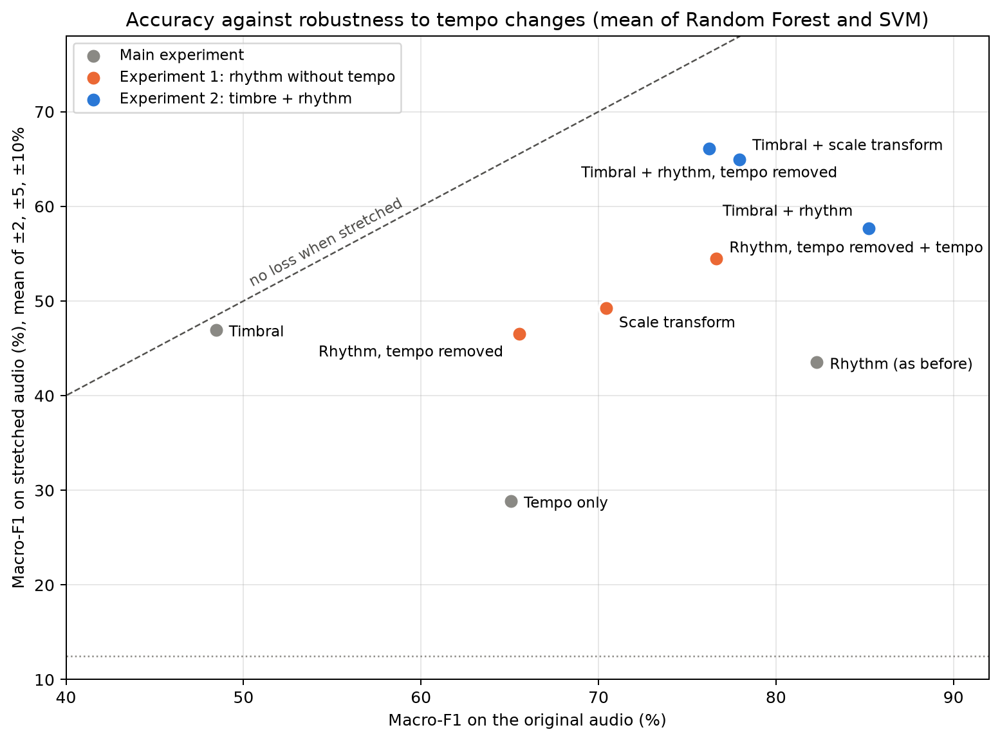
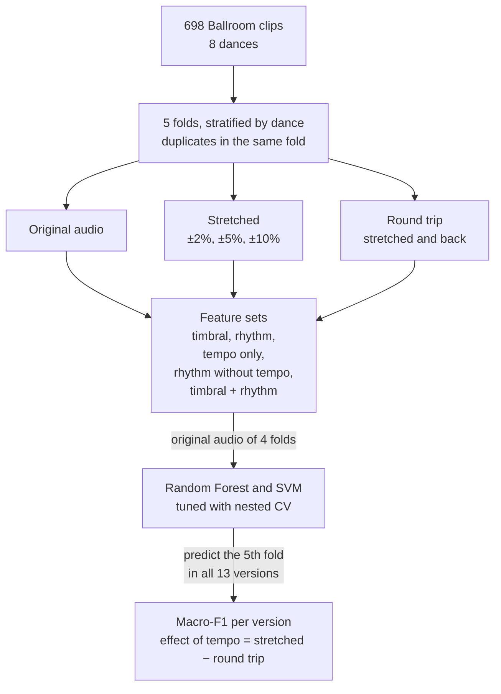
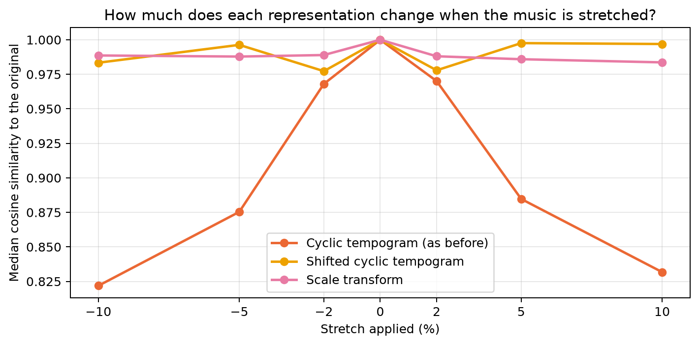
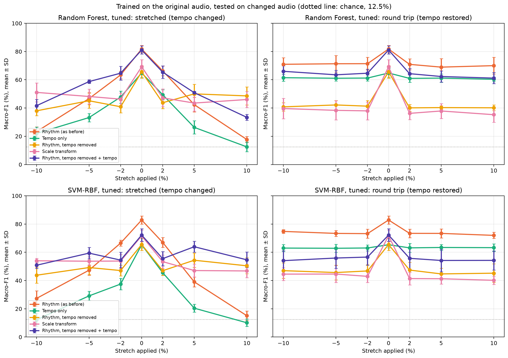
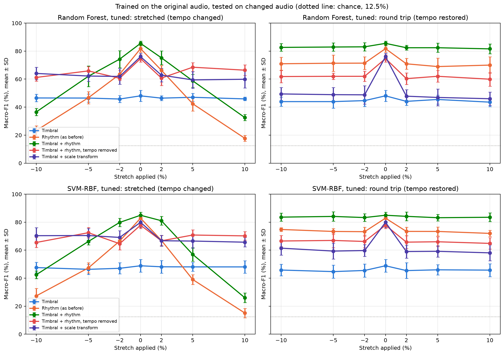
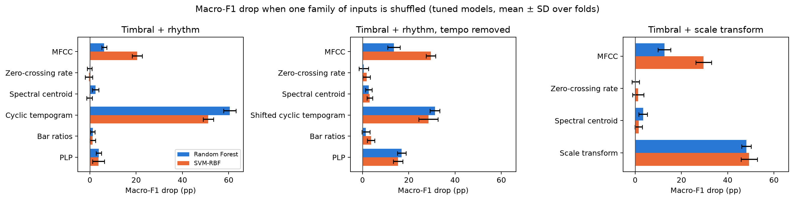

# Rhythm or Just Tempo?

Testing a ballroom dance classifier with time-stretched audio. Final project in DT2470 Music Informatics at KTH.

## Summary

We classify the 8 dance styles of the Ballroom dataset from audio and test whether the classifiers learn the style or just use the tempo. The models are trained on the original recordings. Then we time-stretch the test recordings by up to ±10% (the pitch stays the same) and look at how the predictions change. We use timbral features, rhythm features, the tempo alone, rhythm features with the tempo removed, and timbre and rhythm together, each with a Random Forest and an SVM.

| Macro-F1, tuned Random Forest | Original | -10% tempo | +10% tempo | Round trip |
|---|---:|---:|---:|---:|
| Rhythm features | 81.8% | 23.3% | 17.7% | 70.6% |
| Tempo only | 64.8% | 22.0% | 12.5% | 61.0% |
| Timbral features | 48.0% | 46.5% | 45.9% | 44.3% |
| Rhythm features, tempo removed | 65.6% | 38.0% | 48.6% | 40.8% |
| Timbral + rhythm features | 85.5% | 36.5% | 32.5% | 82.5% |
| Timbral + rhythm features, tempo removed | 74.7% | 61.2% | 66.4% | 61.3% |

Mean over the 5 test folds; chance level is 12.5%. The SVM gives almost the same numbers (section 7). "Round trip" means the audio is stretched and then stretched back, so the tempo is the original one but the audio has gone through the same processing.

- The rhythm features reach about 82% on the original audio but only about 18% when the music is played 10% faster. The round trip costs about 11 points, so most of the drop comes from the tempo change itself.
- The timbral features hardly change under stretching, but on their own they only reach about 48%.
- With the tempo removed, the rhythm features still reach 66-72%, and together with timbre 75-78%, and they lose nothing to the tempo change.

So on Ballroom, most of what the rhythm models get right comes from the tempo. The rhythm pattern does carry information about the dance, but when the tempo is available the models rely on it.

<p align="center"></p>

Every dot is one feature set (mean of Random Forest and SVM). Right means more accurate on the original audio, up means it still works when the tempo changes, and a dot on the dashed line loses nothing when the music is stretched.

Terms like round trip or pp (percentage points) are explained in [section 12](#12-terms).

## 1. Question

Each ballroom dance is danced in a fairly narrow tempo range: a Quickstep is fast and a Waltz is slow. So a classifier can do well on this task just by measuring how fast the music is, without learning anything about the rhythmic pattern, the metre or the instruments.

Our question: does a dance-style classifier learn the style, or does it use the tempo as a shortcut? And if the tempo is taken away, how much of the style can the rhythm and timbral features still recognise?

To test this we play the test recordings slightly faster or slower (±2%, ±5%, ±10%) with the pitch unchanged. A model that has learned the style should barely be affected. A model that relies on the tempo should get much worse, because the stretched clip now has the tempo of a different dance. The idea comes from Sturm (2014): change one property of the input in a controlled way and check whether the decisions follow that property.

## 2. Dataset

The Ballroom dataset from the ISMIR 2004 contest (Gouyon et al., 2006): 698 mono clips of about 30 s in 8 classes (ChaChaCha 111, Jive 60, Quickstep 82, Rumba 98, Samba 86, Tango 86, VienneseWaltz 65, Waltz 110). The three Rumba folders are merged into one class, as in the usual 8-class task. There are 13 known pairs of duplicate recordings (from BallroomAnnotations), which we always keep in the same fold.

The classes are imbalanced, so we use macro-F1 as the main metric. It gives every dance the same weight.

## 3. Pipeline



Each fold is the test fold once. The models only ever see the original audio during training, and the round trip shows how much of a drop comes from the stretching process rather than the tempo (section 6).

The timbral notebooks run this for the timbral features (the features of the original clips come from `Timbral_extraction.ipynb`), the rhythm notebooks for the rhythm and tempo-only features, and the two notebooks in `further_experiments/` for the tempo-free and combined sets.

### Example: one Waltz clip

`Albums-Ballroom_Classics4-02.wav` is a Waltz in test fold 1. The table shows its estimated tempo and the predictions of the tuned Random Forests.

| Version | Estimated tempo (BPM) | Timbral model | Rhythm model | Tempo-only model |
|---|---:|---|---|---|
| -10% | 156.8 | Waltz | Rumba | Jive |
| -5% | 165.4 | Waltz | Waltz | Waltz |
| -2% | 171.0 | Waltz | Waltz | Waltz |
| original | 174.1 | Waltz | Waltz | Waltz |
| +2% | 177.8 | Waltz | VienneseWaltz | VienneseWaltz |
| +5% | 183.2 | Waltz | Rumba | Rumba |
| +10% | 191.8 | Waltz | Rumba | Rumba |
| round trip of +10% | 174.3 | Waltz | Waltz | Waltz |

The estimated tempo follows the stretch. When it reaches the VienneseWaltz range (around 178 BPM), the rhythm and tempo-only models predict VienneseWaltz, and further up, towards Rumba's 199 BPM, they predict Rumba. After the round trip the prediction is Waltz again. The timbral model cannot see the tempo and predicts Waltz every time.

## 4. Features

### Timbral set (30 inputs)

| Feature | Inputs | Describes |
|---|---:|---|
| MFCC 0-12, mean and std over frames | 26 | the spectral envelope: instruments, production |
| Zero-crossing rate, mean and std | 2 | noisiness, amount of percussion |
| Spectral centroid, mean and std | 2 | brightness |

Computed with our own NumPy code (`Timbral_extraction.ipynb`, checked against librosa), with frames of 2048 samples, a hop of 512 and 128 Mel bands. The mean and std over frames don't depend on the order of the frames, so these features cannot see the beat. That makes the timbral set a useful control: if it changed a lot under stretching, the problem would be the processing and not the tempo.

### Rhythm set (20 inputs)

All rhythm features come from the novelty curve (spectral flux), which has a peak wherever a note or a drum hit starts. From it we compute a Fourier tempogram and an autocorrelation tempogram with a window of 512 frames (11.9 s). The settings follow `src/Rythm_extraction.py`, except the upper tempo limit (section 7.8).

| Feature | Inputs | Describes |
|---|---:|---|
| Cyclic tempogram (Müller, 2015, ch. 6) | 15 | the tempogram folded into one octave, 15 bins per octave (4.7% per bin); which tempo classes are present |
| Bar ratios `R_2_4`, `R_3_4`, `R_4_4` | 3 | autocorrelation at 2, 3 and 4 beats relative to 1 beat; meant to describe the metre (weak in practice, section 8) |
| PLP confidence | 1 | how clear and steady the pulse is |
| PLP alignment | 1 | how well the accents of the music line up with the pulse |

### Tempo-only set (1 input)

`tau_hat` is the strongest tempo between 60 and 280 BPM of the Fourier tempogram multiplied by the autocorrelation tempogram (Müller, 2015, p. 330). The first favours a tempo and its multiples and the second a tempo and its fractions, so their product keeps the tempo both agree on.

### Tempo-free rhythm sets and combinations

| Feature set | Inputs | What it is |
|---|---:|---|
| Rhythm, tempo removed | 20 | the rhythm set with a shifted cyclic tempogram: the profile is rotated so that its strongest bin is always the first one, so it keeps its shape but no longer says which tempo class the clip is in (`cyclic_shift=True` in `src/Rythm_extraction.py`) |
| Scale transform | 20 | the scale transform (Holzapfel & Stylianou, 2011) of the autocorrelation of the novelty curve. When the music is played faster, the autocorrelation is squeezed but keeps its shape; on a log lag axis the squeeze becomes a shift, and the magnitude of a Fourier transform ignores shifts |
| Rhythm, tempo removed + tempo | 21 | the tempo-free rhythm set plus `tau_hat` |
| Timbral + one of the rhythm sets | 50 | timbre together with the rhythm set, the tempo-free rhythm set or the scale transform |

<p align="center"></p>

Median cosine similarity between each representation of the original clip and of its stretched version (1 = unchanged). The cyclic tempogram moves with the tempo (0.82-0.83 at ±10%), while the two tempo-free representations stay at 0.98 or higher.

## 5. Classifiers and evaluation

We use a Random Forest and an SVM with an RBF kernel (with a `StandardScaler` fitted on the training clips). They decide in very different ways, so if both give the same result, the result says something about the features and not about one model.

- Stratified and grouped 5-fold cross-validation: every fold has about the same share of each dance, and duplicates are always in the same fold. All notebooks use the same `folds.csv`.
- Nested tuning: inside the 4 training folds, a grid search on 3 inner folds picks the settings with the best macro-F1. The test fold is never used for training or tuning.
- We report the tuned model and keep the default model for reference.
- Results are mean ± SD over the 5 test folds.

## 6. The time-stretch experiment

Every clip exists in 13 versions:

| Version | Tempo change | What it tests |
|---|---|---|
| original | 0% | the baseline (the models were trained on these) |
| stretch by 0.90, 0.95, 0.98, 1.02, 1.05, 1.10 | -10% … +10% | tempo change plus processing artefacts |
| round trip (stretch by r, then by 1/r) | 0% | processing artefacts only |

The stretching is done with librosa's phase vocoder, which changes the speed but keeps the pitch. It also smears sharp attacks, so a drop could come from these artefacts instead of the tempo. The round trip has the same processing but no change in tempo, so only the part of a drop that does not also show up in the round trip can be explained by the tempo. Only the test audio is stretched; the models are always trained on the original recordings.

## 7. Results

All numbers are for the tuned models, averaged over the 5 test folds. All tables and figures are in [`results/`](results/).

### 7.1 Original audio

| Feature set | Classifier | Accuracy (%) | Macro-F1 (%) |
|---|---|---|---|
| Timbral | Random Forest | 49.71 ± 4.02 | 48.05 ± 3.94 |
| Timbral | SVM-RBF | 50.58 ± 3.86 | 48.86 ± 4.49 |
| Rhythm | Random Forest | 82.24 ± 2.19 | 81.76 ± 2.56 |
| Rhythm | SVM-RBF | 82.95 ± 2.75 | 82.85 ± 2.86 |
| Tempo only | Random Forest | 65.90 ± 3.56 | 64.80 ± 3.33 |
| Tempo only | SVM-RBF | 67.05 ± 1.71 | 65.35 ± 2.14 |

All three sets are well above chance. The rhythm set is the best, and the tempo alone already reaches about 65%.

<p align="center"></p>

Confusion matrices of the tuned Random Forest on the original audio (left: rhythm, right: tempo only). The tempo-only model mixes up dances with similar tempi: Samba with Quickstep and Rumba (around 200 BPM), and Waltz with Jive (around 170 BPM).

The tempo alone works because each dance has its own tempo range:

| Dance | Nominal tempo (BPM, Dixon et al., 2004) | Our median `tau_hat` (BPM) |
|---|---|---:|
| Tango | 128-132 | 255.6 (two groups, around 129 and 256) |
| ChaChaCha | 128 | 248.0 |
| Jive | 176 | 172.1 |
| Waltz | 84-90 | 168.8 (two groups, around 87 and 170) |
| VienneseWaltz | 174-180 | 177.7 |
| Rumba | 104 | 199.4 |
| Samba | 200 | 199.5 (two groups, around 110 and 200) |
| Quickstep | 200-208 | 203.7 |

For many clips the estimate is twice the nominal tempo (an octave error), but it is consistent within a dance. The groups are only 2-3% apart, which is why even a ±2% stretch moves many clips to another dance.

### 7.2 Macro-F1 (%) when only the tempo changes

| Tempo change | Timbral RF | Timbral SVM | Rhythm RF | Rhythm SVM | Tempo RF | Tempo SVM |
|---|---:|---:|---:|---:|---:|---:|
| -10% | 46.5 | 47.6 | 23.3 | 27.3 | 22.0 | 12.2 |
| -5% | 46.5 | 46.3 | 46.7 | 47.3 | 33.3 | 29.1 |
| -2% | 45.8 | 47.1 | 63.4 | 66.5 | 47.8 | 37.5 |
| 0% (original) | 48.0 | 48.9 | 81.8 | 82.9 | 64.8 | 65.3 |
| +2% | 46.4 | 48.1 | 66.3 | 67.0 | 49.4 | 45.6 |
| +5% | 47.0 | 48.1 | 42.4 | 39.0 | 26.3 | 20.4 |
| +10% | 45.9 | 48.1 | 17.7 | 15.1 | 12.5 | 10.1 |
| Round trip, mean of 6 | 44.3 | 45.5 | 70.6 | 73.4 | 61.0 | 63.1 |

<p align="center"></p>

Macro-F1 of the tuned Random Forest. Left: stretched test audio. Right: round trip. The [SVM version](results/rhythm_svm_rbf/comparison/feature_set_comparison.png) looks almost the same.

<p align="center"></p>

Random Forest (blue) and SVM-RBF (orange) follow the same curves, for the rhythm set (left) and the tempo-only set (right).

### 7.3 How much of the drop comes from the tempo?

Average change in macro-F1 over the six stretches and over the six round trips, in percentage points (pp):

| Feature set | Classifier | Stretched | Round trip | Caused by tempo | Predictions that change |
|---|---|---:|---:|---:|---:|
| Timbral | RF | -1.7 | -3.8 | ≈ 0 | 15% |
| Timbral | SVM | -1.3 | -3.3 | ≈ 0 | 15% |
| Rhythm | RF | -38.5 | -11.2 | -27.3 | 52% |
| Rhythm | SVM | -39.1 | -9.5 | -29.6 | 52% |
| Tempo only | RF | -32.9 | -3.8 | -29.2 | 59% |
| Tempo only | SVM | -39.5 | -2.2 | -37.3 | 68% |

For the timbral set the stretch hurts less than the round trip, so there is no tempo effect. For the rhythm and tempo-only sets the predictions move to the dance whose tempo the stretched clip now has: at +10% the rhythm Random Forest predicts Rumba for 273 of the 698 clips, although only 98 of them are Rumba.

<p align="center"></p>

Change in F1 per dance for the rhythm Random Forest. Every dance gets worse under stretching, by 50-83 points at +10%. The round trips cost 0-12 points for most dances, but 25-35 points for Jive and Samba.

### 7.4 Which features the models use

Group permutation importance: we shuffle one feature family across the test clips and measure how much macro-F1 drops (pp).

| Family | Inputs | Drop, RF | Drop, SVM |
|---|---:|---:|---:|
| Cyclic tempogram | 15 | 65.7 | 63.9 |
| PLP confidence and alignment | 2 | 14.0 | 19.4 |
| Bar ratios | 3 | 2.3 | 2.9 |
| MFCC | 26 | 30.5 | 33.2 |
| Spectral centroid | 2 | 4.7 | 3.6 |
| Zero-crossing rate | 2 | 1.7 | 2.7 |

The rhythm model depends mostly on the cyclic tempogram, which is the rhythm feature that contains the tempo class.

### 7.5 Sanity checks

- The tempo estimate follows the stretch: the median of `tau_hat(stretched) / tau_hat(original)` equals the stretch rate, and 89-95% of the clips are within 1% of it ([figure](results/rhythm_random_forest/comparison/tempo_check.png)).
- The timbral model does not depend on loudness: without `mfcc_00` the macro-F1 is 43.75% (RF) and 49.03% (SVM).
- Tuning changes little for the timbral and rhythm sets, but a lot for the tempo-only SVM (51.70% → 65.35%).
- With shuffled labels the whole cross-validation gives 11-15% accuracy (chance level), so no label information leaks into the features or folds. On synthetic click tracks the features behave as expected, and recomputing all metrics with separate NumPy code gives the same numbers.

### 7.6 Rhythm without the tempo

Macro-F1 in %, Random Forest / SVM.

| Feature set | Original audio | At +10% tempo | Round trip (pp) | Caused by tempo (pp) |
|---|---:|---:|---:|---:|
| Tempo only | 65 / 65 | 12 / 10 | -3.8 / -2.2 | -29.2 / -37.3 |
| Rhythm | 82 / 83 | 18 / 15 | -11.2 / -9.5 | -27.3 / -29.6 |
| Rhythm, tempo removed (shifted tempogram) | 66 / 66 | 49 / 50 | -24.8 / -19.4 | none (+3.6 / +2.5) |
| Scale transform | 69 / 72 | 46 / 47 | -31.6 / -29.2 | none (+9.5 / +9.0) |
| Rhythm, tempo removed + tempo | 81 / 72 | 33 / 55 | -17.4 / -17.1 | -11.2 / none |

<p align="center"></p>

- The rhythm pattern alone recognises the dances well above chance: 66% with the shifted tempogram and 69-72% with the scale transform, about as good as the tempo alone.
- Without the tempo, there is no drop caused by the tempo. The tempo-free sets still lose under stretching, but as much or more in the round trip, so they are sensitive to the processing itself. A feature that is tempo-invariant on paper is not automatically robust in practice.
- The shifted tempogram is worse at ±2% than at ±5%: a 2% stretch moves the profile by half a bin and changes its shape, while 5% and 10% move it by almost whole bins.
- When the tempo is added back, the Random Forest relies on it again (shuffling `tau_hat` costs 46 points) and becomes fragile again. The SVM uses it much less (14 points).

### 7.7 Timbre and rhythm together

| Feature set | Original audio | At +10% tempo | Round trip (pp) | Caused by tempo (pp) |
|---|---:|---:|---:|---:|
| Timbral | 48 / 49 | 46 / 48 | -3.8 / -3.3 | none (+2.1 / +2.0) |
| Rhythm | 82 / 83 | 18 / 15 | -11.2 / -9.5 | -27.3 / -29.6 |
| Timbral + rhythm | 86 / 85 | 33 / 26 | -3.0 / -1.3 | -25.9 / -24.9 |
| Timbral + rhythm, tempo removed | 75 / 78 | 66 / 70 | -13.3 / -11.8 | none (+2.5 / +2.3) |
| Timbral + scale transform | 76 / 80 | 60 / 66 | -28.0 / -20.4 | none (+13.8 / +8.7) |

<p align="center"></p>

<p align="center"></p>

Macro-F1 drop when one family of inputs is shuffled (Random Forest in blue, SVM in orange).

- Timbre and rhythm together give the best score on unchanged audio (85-86%), but still lose about 25 points when the tempo changes. Shuffling the cyclic tempogram costs 51-61 points, shuffling the MFCCs only 6 (RF) to 21 (SVM), so the model still relies on the tempo.
- Timbre with the tempo-free rhythm set is the most robust model: 75-78% on the original audio and 66-70% at +10% tempo. Without the tempo, the MFCCs become about twice as important.
- So there is a trade-off: the tempo gives the best score on unchanged audio, and removing it gives a model that keeps working when the tempo changes. On Ballroom the tempo is worth about 10-15 points of macro-F1.

### 7.8 Choosing the tempo range

`tau_hat` is the strongest tempo between a lower and an upper limit, and these limits matter. When the tempo of a clip, or its double, is close to a limit, a small stretch can push it over the limit, and the estimate jumps to another metrical level (an octave error, for example from 220 to 110 BPM). In this experiment the estimate has to follow the stretch, so before running the experiments we tested several ranges. For every clip and every stretch, the estimate counts as correct if it equals the estimate on the original clip × the stretch rate, within 1%. This check uses no labels and no classifier results.

Share of the 698 clips where the estimate follows the stretch (%):

| Tempo range (BPM) | -10% | -5% | -2% | +2% | +5% | +10% | Average |
|---|---:|---:|---:|---:|---:|---:|---:|
| 60-220 (the value in `src/Rythm_extraction.py`) | 80 | 90 | 88 | 89 | 91 | 75 | 85 |
| 60-240 | 76 | 78 | 82 | 87 | 88 | 87 | 83 |
| 60-260 | 94 | 92 | 91 | 90 | 84 | 73 | 88 |
| **60-280 (used)** | **95** | **94** | **93** | **92** | **92** | **89** | **93** |
| 60-300 | 95 | 94 | 93 | 93 | 93 | 92 | 93 |
| 110-220 | 80 | 94 | 91 | 93 | 93 | 75 | 88 |
| 120-240 | 71 | 77 | 83 | 89 | 89 | 88 | 83 |

- With an upper limit of 220 or 260 BPM, fast dances stretched by +10% go over the limit (Quickstep at about 204-211 BPM becomes 224-232 BPM), and the estimate drops to half.
- With 240 BPM, songs at about 115 BPM are sometimes estimated at 230 BPM, so they jump already at small stretches.
- A higher lower limit (110 or 120 BPM) does not help.
- With 280 BPM even the fastest stretched songs (about 270 BPM) stay inside the range, so we use 280 BPM (300 BPM gives almost the same result and would also be fine).

With a high upper limit, the estimate is more often at double the danced tempo (section 7.1): only 41% of the clips are within 4% of the BPM in the dataset annotations, but 95% are within 4% of that BPM or a simple multiple of it (×2, ×3, ×½, ×⅓). This is not a problem for our experiment, because the octave error is consistent within a dance and the estimate still follows every stretch.

## 8. Known issues

- The bar ratios carry only a weak metre signal, partly because the tempo estimate is often twice the danced tempo (an octave error), so the ratios are measured at the wrong level.
- The PLP features and the tempo-free features are sensitive to the stretching process itself, which is why their round trip drops are large.
- librosa's PLP function (version 1.0) normalises only about half of the frames as intended. The PLP values still behave sensibly.

## 9. Reproducing the results

We used Python 3.12 with numpy, pandas, scipy, scikit-learn 1.9, librosa 1.0, matplotlib, seaborn and joblib. All random seeds are fixed (`RANDOM_SEED = 2026`).

```bash
pip install numpy pandas scipy scikit-learn librosa matplotlib seaborn joblib jupyter
```

Run the notebooks from the repository folder, with `DATASET_DIR` pointing to the `BallroomData` folder:

1. `Timbral_extraction.ipynb` computes `data/ballroom_timbral_features_scratch.csv`. The file is already in the repository, so this step can be skipped.
2. `Timbral_Random_Forest.ipynb`, then `Timbral_SVM_RBF.ipynb`. The first creates `folds.csv` and the timbral features of all 13 versions; the second reuses them.
3. `Rhythm_Random_Forest.ipynb`, then `Rhythm_SVM_RBF.ipynb`. The first computes the rhythm features of all 13 versions; the second reuses them.
4. The model comparisons read the results of the other notebook of the pair, so rerun the first notebook of each pair once at the end.
5. From inside `further_experiments/`: `Rhythm_Without_Tempo.ipynb` (computes all features of all 13 versions, about 20 minutes), then `Timbre_Plus_Rhythm.ipynb`.

## 10. Project layout

```
music-informatics-project/
├── Timbral_extraction.ipynb          timbral features of the original clips
├── Timbral_Random_Forest.ipynb       timbral experiment, Random Forest
├── Timbral_SVM_RBF.ipynb             timbral experiment, SVM-RBF
├── Rhythm_Random_Forest.ipynb        rhythm + tempo-only experiment, Random Forest
├── Rhythm_SVM_RBF.ipynb              rhythm + tempo-only experiment, SVM-RBF
├── further_experiments/              rhythm without the tempo, timbre + rhythm (sections 7.6 and 7.7)
├── previous_runs/max_tempo_220/      the same experiments with the tempo range 60-220 BPM
├── src/                              feature extraction scripts
├── data/                             timbral features of the original clips
└── results/                          tables and figures written by the notebooks
```

`folds.csv`, the feature files of the 13 versions and the audio are created by the notebooks and are not stored in git.

## 11. References

- F. Gouyon et al. *An experimental comparison of audio tempo induction algorithms.* IEEE TASLP, 2006. (Ballroom dataset)
- S. Dixon, F. Gouyon, G. Widmer. *Towards characterisation of music via rhythmic patterns.* ISMIR, 2004. (nominal dance tempi)
- B. L. Sturm. *A simple method to determine if a music information retrieval system is a "horse".* IEEE Transactions on Multimedia, 2014.
- M. Müller. *Fundamentals of Music Processing.* Springer, 2015, chapter 6.
- A. Holzapfel, Y. Stylianou. *Scale transform in rhythmic similarity of music.* IEEE TASLP, 2011.
- BallroomAnnotations (CPJKU), https://github.com/CPJKU/BallroomAnnotations (list of duplicate recordings).

## 12. Terms

| Term | Meaning |
|---|---|
| Round trip | Stretching the audio and then stretching it back: same processing, original tempo |
| Caused by tempo | The change under stretching minus the change in the round trip |
| pp | Percentage points: going from 80% to 50% is a drop of 30 pp |
| Shifted cyclic tempogram | A cyclic tempogram rotated so that its strongest bin is always the first one, so it no longer shows the tempo class |
| Scale transform | A transform whose magnitude does not change when a signal is stretched in time |
| Flip rate | Share of clips whose prediction changes between the original and the stretched audio |
