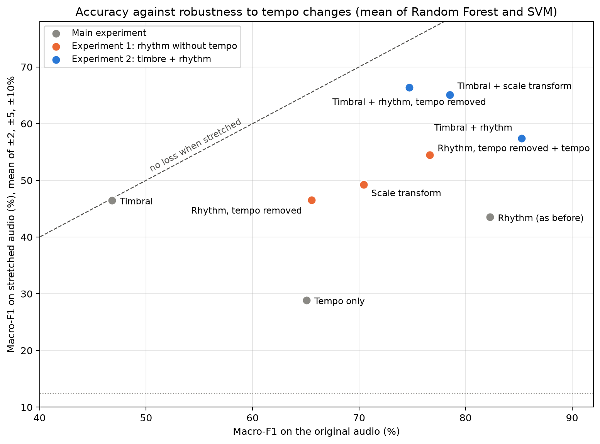

# Extra experiments

## In short

**Why we did this.** In the main experiment the rhythm models got about 82% but collapsed when the tempo changed, because our cyclic tempogram still told the model the tempo. So we didn't know yet if rhythm itself can recognise the dances. We also wanted to know if adding timbre makes a model more robust.

**What we changed.** We removed the tempo from the rhythm features in two ways (a shifted cyclic tempogram and a scale transform, explained below), and we trained models on timbre and rhythm together. Data, folds, classifiers, tuning and time-stretching are the same as in the main experiment. The rhythm features use the updated `src/Rythm_extraction.py` with a tempo range of 60–280 BPM (see "Earlier runs" below for why 280).

**How to read the numbers.** All scores are macro-F1 in %: the F1 score of each dance, averaged over the 8 dances, so every dance counts the same (chance is 12.5%). Changes are in percentage points (pp), the plain difference between two percentages: going from 80% to 50% is a drop of 30 pp.

**What we found:**

- **Rhythm without the tempo still gets 66-72% macro-F1 (chance is 12.5%, tempo alone 65%), and the tempo no longer causes any drop (against 27-30 pp for the normal rhythm features).** So the rhythm pattern carries real information, and the tempo is a shortcut on top of it.
- **Timbre + tempo-free rhythm is the most robust model we have: 73-76% on the original audio, no drop caused by tempo changes, and 66-72% at +10% tempo, against 27-33% for timbre + the normal rhythm features.**
- **Adding timbre to the normal rhythm features gives the best score (85%) but does not remove the shortcut.** The model still relies mostly on the tempo and collapses at +10%.
- The tempo-free features are sensitive to the time-stretching process itself: the shifted tempogram set loses 19-25 pp and the scale transform 29-32 pp even in the round trip, where the tempo is unchanged. So a feature that is tempo-invariant on paper is not automatically robust.

**Main message for the paper:** on Ballroom the tempo is worth about 10-15 pp of macro-F1. The rest can be reached without it, but when the tempo is available, the models prefer it, even when other useful features are there.

<p align="center"></p>

Every dot is one feature set (mean of Random Forest and SVM). Right means more accurate on the original audio, and up means it still works when the tempo changes. A dot on the dashed line loses nothing when the music is stretched. The old rhythm features (grey, bottom right) are accurate but fragile. The two blue dots at the top, timbre with tempo-free rhythm, give the best balance.

## The two tempo-free rhythm features

**Shifted cyclic tempogram.** Our cyclic tempogram has 15 bins, and the bin with the most energy tells the model the tempo class of the clip. We rotate the profile so that this bin is always the first one. The shape of the profile stays, but the tempo class is gone. This is the `cyclic_shift=True` option of `Rythm_extraction.py`.

**Scale transform** (Holzapfel & Stylianou, 2011). The autocorrelation of the novelty curve shows after which time lags the music repeats itself (one beat, two beats, one bar). When the music is played faster, this curve gets squeezed but keeps its shape. The scale transform describes that shape and ignores the squeeze, so it doesn't change when the music is stretched. It is the same idea as Jensen et al. (2009) from our proposal.

We checked that both really ignore the tempo: under a ±10% stretch the old cyclic tempogram changes a lot (median cosine similarity 0.82-0.83), while the two new features stay almost the same (0.98 or higher).

## Results

Tuned models, macro-F1 in %, Random Forest / SVM, mean over the 5 test folds. "Drop caused by tempo" is the drop under stretching minus the drop in the round trip (stretched and stretched back), the same measure as in the main README.

| Feature set | Original audio | At +10% tempo | Drop caused by tempo (pp) |
|---|---:|---:|---:|
| Timbral | 46 / 47 | 45 / 47 | none |
| Tempo only | 65 / 65 | 13 / 10 | −29 / −37 |
| Rhythm (as before) | 82 / 83 | 18 / 15 | −27 / −30 |
| Rhythm, tempo removed (shifted tempogram) | 66 / 66 | 49 / 50 | none |
| Scale transform | 69 / 72 | 46 / 47 | none |
| Rhythm, tempo removed + tempo added back | 81 / 72 | 33 / 55 | −11 / none |
| Timbral + rhythm | 85 / 85 | 33 / 27 | −26 / −25 |
| Timbral + rhythm, tempo removed | 73 / 76 | 66 / 72 | none |
| Timbral + scale transform | 76 / 81 | 60 / 65 | none |

What the numbers mean:

- **The tempo-free models still drop under stretching, but not because of the tempo.** They lose as much or more in the round trip, where the tempo is unchanged, as under stretching. The rhythm features are built from drum attacks, which the stretching smears, and the PLP features of the updated extraction react strongly to that.
- **The shifted tempogram is worse at ±2% than at ±5%.** One bin covers about 4.7% of tempo. A 5% or 10% stretch moves the profile by almost whole bins, which the rotation removes, but a 2% stretch moves it by half a bin and changes its shape.
- **The combined model ignores the timbre when it can read the tempo.** Shuffling the cyclic tempogram costs timbre + rhythm 51-60 pp of macro-F1, and shuffling the MFCCs only 6 pp (Random Forest) to 20 pp (SVM). Without the tempo, the MFCCs become about twice as important.
- **When the tempo is added back to the tempo-free rhythm features, the Random Forest relies on it again and becomes fragile again.** The SVM uses it much less.

## A note on the bar ratios

The first version of the rhythm features said the bar ratios don't depend on the tempo. That was not fully true: on a click track with equally strong beats they should all be 1, but they ranged from 0.6 to 1.1 depending on the tempo, partly because of the Hann window inside the autocorrelation tempogram. The updated extraction corrects for that window and takes the strongest value within ±5% of each beat. The bar ratios still matter little in every model (at most about 5 pp of macro-F1 when shuffled).

## Earlier runs

We ran these experiments three times. Only the rhythm features changed between the runs; folds, classifiers, tuning and stretching stayed the same. The timbral and scale transform results are the same in all three.

| Run | Rhythm features | Where |
|---|---|---|
| First run | first version of `Rythm_extraction.py`, tempo range 40–240 BPM, 19 rhythm inputs | git history (commit `4b26d31`) |
| Second run | updated `Rythm_extraction.py`, tempo range 60–220 BPM (the value in the script), 20 rhythm inputs | `previous_runs/max_tempo_220/` |
| **Current run** | updated `Rythm_extraction.py`, tempo range 60–280 BPM | this folder |

Why 280 BPM: with a limit of 220 BPM, fast dances stretched by +10% (for example Quickstep at about 204–211 BPM, which becomes 224–232 BPM) go over the limit and the tempo estimate is forced to jump. With 280 BPM the tempo estimate follows the stretch for 89–95% of the clips at every stretch rate, against 75–91% with 220 BPM and 71–91% in the first run. We chose the limit only from this check, without looking at classifier results. The comparison of all the tempo ranges we tested is in section 7.6 of the [main README](../README.md#76-earlier-runs).

Macro-F1, Random Forest / SVM:

| Feature set | First run (40–240) | Second run (60–220) | Current run (60–280) |
|---|---:|---:|---:|
| Rhythm (as before), original audio | 81 / 80 | 82 / 83 | 82 / 83 |
| … drop caused by tempo (pp) | −31 / −31 | −27 / −27 | −27 / −30 |
| Rhythm, tempo removed, original audio | 65 / 67 | 64 / 63 | 66 / 66 |
| … at +10% tempo | 57 / 53 | 44 / 49 | 49 / 50 |
| … drop caused by tempo (pp) | −9 / −11 | 0 / −4 | none |
| … drop in the round trip (pp) | −5 / −6 | −19 / −11 | −25 / −19 |
| Timbral + rhythm, tempo removed, original audio | 72 / 74 | 71 / 75 | 73 / 76 |
| … at +10% tempo | 69 / 70 | 62 / 65 | 66 / 72 |

The updated extraction makes the rhythm features a bit more accurate and removes the remaining tempo effect from the tempo-free sets, but it also makes them more sensitive to the stretching process (larger round-trip drop). The conclusions are the same in all three runs.

## Files and how to run

```
extra_experiments/
├── features.py                  features of every clip in all 13 versions
├── evaluation.py                folds, classifiers, nested cross-validation, time-stretch evaluation
├── Rhythm_Without_Tempo.ipynb   the tempo-free rhythm features
├── Timbre_Plus_Rhythm.ipynb     timbre and rhythm together
└── results/                     tables and figures of both notebooks
```

`features.py` and `evaluation.py` contain the code of the main notebooks plus the two new features; the reference rows give the same numbers as the main results. Run the notebooks from inside this folder, with `DATASET_DIR` pointing to the `BallroomData` folder. The first notebook computes the features of all versions and saves them in `all_versions_features.csv` (not stored in git); the second one reuses that file.

## Next steps

- Find out which of the updated rhythm features makes the models sensitive to the stretching process (most likely the PLP alignment).
- More bins per octave in the cyclic tempogram, to remove the dip at ±2%.
- A scale transform that is less sensitive to the stretching artifacts.
- Folds grouped by album (the 698 clips come from 53 albums).
- Training on stretched copies (tempo augmentation).

## References

- A. Holzapfel, Y. Stylianou. *Scale transform in rhythmic similarity of music.* IEEE Transactions on Audio, Speech, and Language Processing, 2011.
- J. H. Jensen, M. G. Christensen, S. H. Jensen. *A tempo-insensitive representation of rhythmic patterns.* EUSIPCO, 2009.
